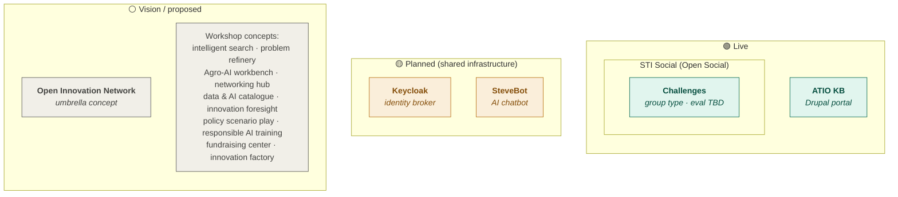
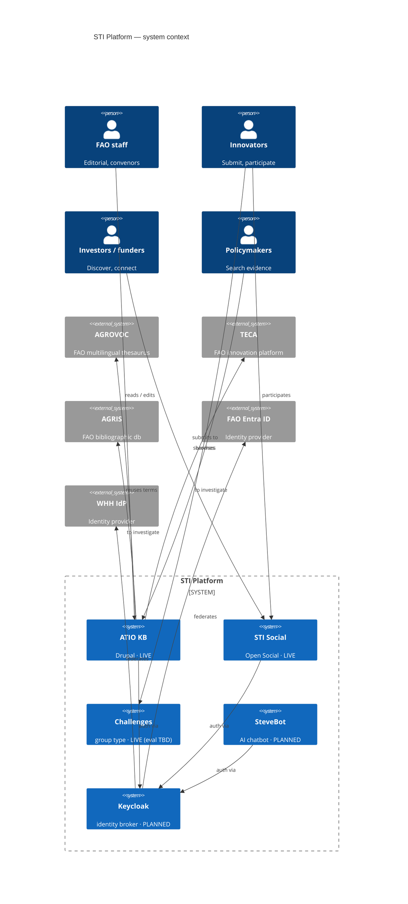

# STI product landscape

Snapshot of what exists, what's being built, and what's been proposed.
Meant as a living document — update as decisions are made.

_Last updated: 2026-04-16_

---

## 1. Product inventory

| Name | Status | Type | Tech | Primary users | URL / location |
|---|---|---|---|---|---|
| **ATIO KB** | Live | Knowledge base | Drupal | FAO staff, policymakers | sti-portal.fao.org |
| **STI Social** | Live | Community / social network | Open Social (Drupal) | FAO staff, innovators | — |
| **Challenges** | Live (partial) | Workflow platform for innovation calls | Open Social group type within STI Social | FAO (as conveners), innovators (as submitters) | Inside STI Social |
| **Keycloak** | Planned (infra) | Identity broker | Keycloak | — (cross-cutting) | ADR-001 |
| **SteveBot** | Planned | AI chatbot | Custom (TS / Python) | All | — |
| **Open Innovation Network** | Vision | Umbrella concept | — | All | Not scoped |

Notes on status:

- **Challenges** is _partially live_: the group type and submission workflow exist, but the evaluation layer (BrightIdea-parity scorecards, multi-framework reasoning) is not yet built. This is the interesting piece architecturally because a generic evaluation layer solves both "reason over innovations" and "different teams want different fields."
- **Open Innovation Network** is a vision statement more than a product — it bundles social + CRM + AI services and overlaps with STI Social and Challenges. Treat as unscoped until someone defines it.

---

## 2. Status view

The asymmetry between the three columns is the point. There are more proposed features than built ones by roughly an order of magnitude, and none of the workshop concepts has an owner, a data model, or a scope definition. Any conversation about the STI portal that doesn't acknowledge this is pretending.

---

## 3. System context (C4-ish)

Things worth noting in this view:

- **Every federation link on the right is proposed, not built.** The diagram shows the target architecture per ADR-001, not today.
- **AGROVOC / TECA / AGRIS are labeled "to investigate"** because the build-vs-link decision has not been made. Whichever direction you go (ingest or reference), it changes the content model.
- **Challenges has no direct user line from FAO** even though FAO runs the challenges — because they do it _through_ STI Social. If FAO needed separate admin UI, that'd be a different line.

---

## 4. Proposed features (not currently scoped)

From the STI workshop slide. None of these has an owner, a data model, or a success metric. Listed here so nothing is forgotten, **not** as a backlog.

**Knowledge / search surface**
- Intelligent search / digital asset explorer
- Innovation/ors taxonomy
- Innovations' data visualization
- Personalized innovation experience

**Innovation workflow**
- Problem refinery
- Innovation foresight
- Policy making scenario play
- Agrifood innovation factory (design, experiment, publish)

**AI / tooling (distinct product family — flag for separation)**
- Agro-AI workbench
- Data and AI catalogue
- Responsible AI training center

**CRM / matchmaking**
- Partner / investor finder
- Networking and partnering hub
- Networkers' onboarding
- Online use-case co-design
- Fundraising center
- Investors' arena

The Agro-AI / training items are arguably a separate product altogether and shouldn't share a roadmap with the KB and CRM work.

---

## 5. Open questions

Things that need an answer before the next workshop:

1. **What is an "innovation"?** Technology? Practice? Project? Case study? The whole content model hangs on this.
2. **What is the minimal core** — the 5–8 properties every innovation record has regardless of team?
3. **Build or link?** Do we ingest from TECA / AGRIS / WOCAT / CGIAR repos, or maintain pointers and add a connection layer?
4. **Who owns each product line?** ATIO funds the devs; Unit 5 owns direction for some things; the Challenges feature has no clear owner. This needs to be named per product.
5. **Does Open Innovation Network exist as a product, or is it a bucket label for "things we haven't scoped"?** If the former, scope it. If the latter, stop using the name.
6. **Which workshop concepts do we strike?** A list that only grows is not a roadmap.

---

## 6. Proposed next fields for the inventory

When filling in the product table for real, each row probably needs:

- `status` — live / in_development / planned / vision
- `owner` — accountable person
- `funder` — who pays (ATIO / Unit 5 / other)
- `primary_users` vs `secondary_users`
- `core_entities` — the data-model fingerprint; products with overlapping entities probably need a shared backbone
- `integrates_with` — other STI products
- `overlaps_with` — honest overlap disclosure
- `external_sources` — AGROVOC, TECA, etc.
- `success_metric` — how we'd know it's working (likely blank for most, and that's the point)
